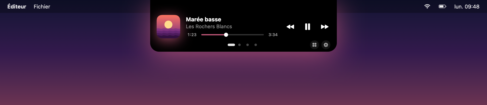
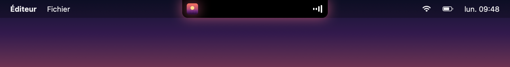
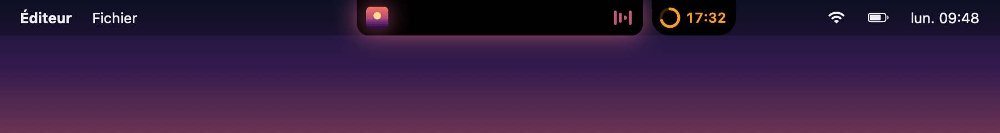
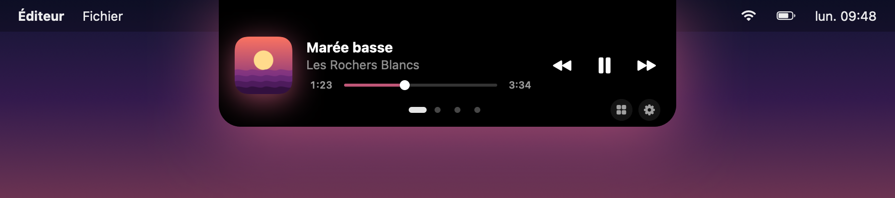
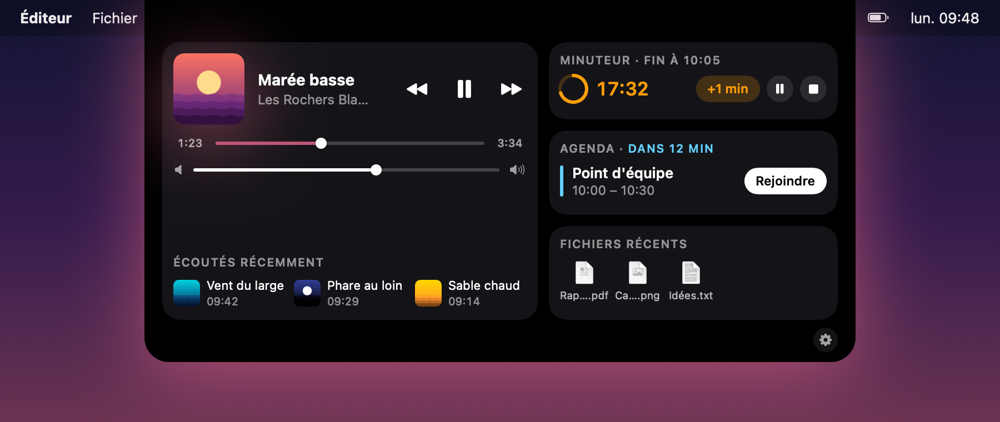
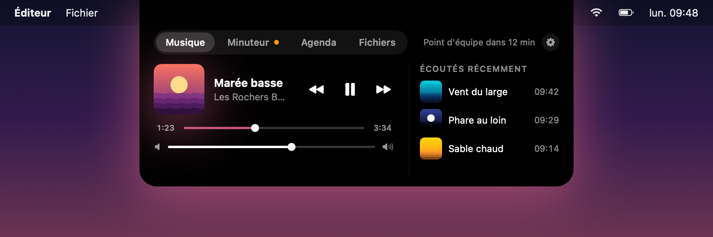
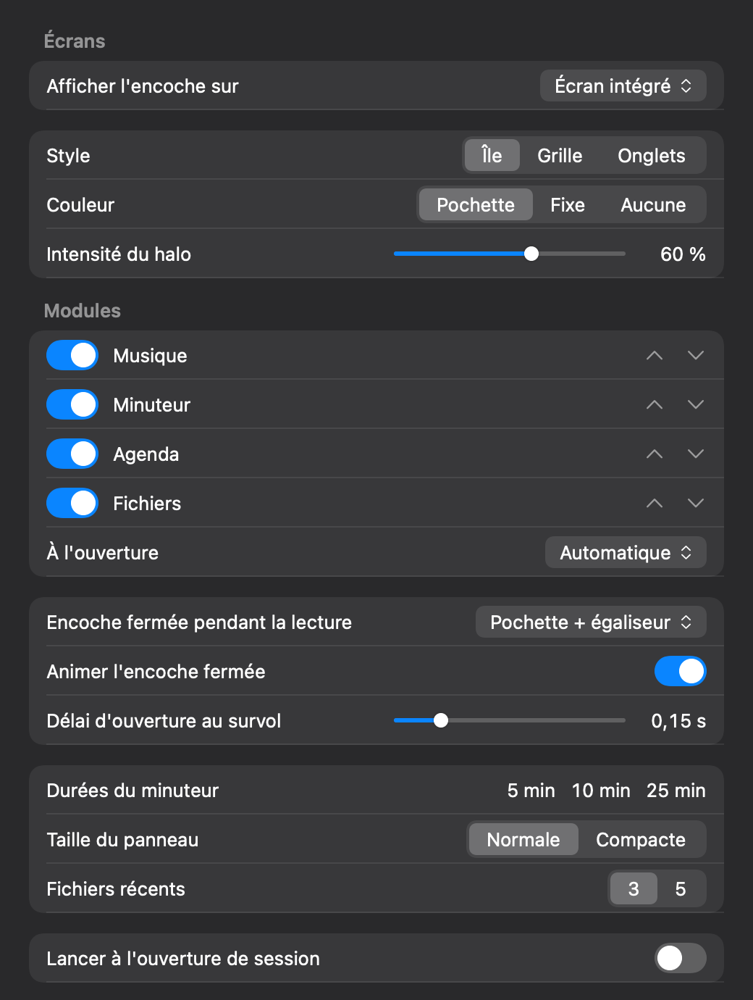
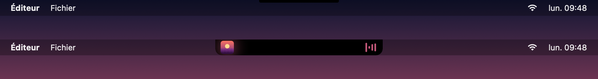

<div align="center">

# ileDelbe

**Your MacBook notch, turned into a little Dynamic Island.**

Now Playing controls, a timer, your next meetings and recent files, one hover away.

[](LICENSE)
[](#requirements)
[](Package.swift)



</div>

ileDelbe is a small, native macOS agent app (SwiftUI, no Dock icon, no menu bar item). It sits on the notch, grows when something happens, and opens into a panel when you hover it. It never steals focus, and clicks outside its shape go to the menu bar as usual.

> The app's interface is in French for now (*Musique*, *Minuteur*, *Agenda*, *Fichiers*, *Réglages*). This README is in English.

## Features

- **Now Playing in the notch.** While something plays, the notch grows small wings: the artwork on the left, an animated equalizer on the right. It follows whatever macOS treats as "Now Playing": Spotify, Music, a YouTube tab, and so on.
- **Three panel styles.** *Île* (the default), *Grille* and *Onglets*: pick the one you like in the settings. See [Styles](#styles).
- **Settings window.** Accent color, halo, modules, closed notch, timer presets and more. See [Settings](#settings).
- **Media panel.** Hover to open: artwork, title, artist, play/pause, previous, next, a seek bar and the system volume. The Grille card and the Onglets tab (and « Tout voir » on Île) also list your last 3 tracks.
- **Artwork-colored halo.** The average color of the current artwork tints a soft glow around the notch, the panel, and the seek bar. Grey or very dark artwork gives no glow.
- **Timer.** One timer at a time, started from three presets (5, 10 and 25 min by default, configurable in the settings), with +1 min, pause and stop. When it ends, macOS plays the "Glass" sound and the notch turns orange until you look at it. It survives a relaunch.
- **Timer bubble.** When a timer runs while music plays, the timer moves to a small bubble next to the notch, like two iPhone Live Activities.
- **Agenda.** Your next 2 events in the next 24 hours from all your macOS calendars, with a **Rejoindre** (join) button for Google Meet, Zoom and Microsoft Teams links. An imminent event shows as "<title> dans N min" in the panel.
- **Recent files.** Your 3 or 5 most recently used files (configurable in the settings), as in Finder's Recents. Click to open, or drag one out of the panel into another app.

## Screenshots

| Closed, music playing | Closed, music + timer bubble |
| :---: | :---: |
|  |  |

<sub>These images are rendered from the app's real SwiftUI views with made-up sample data (`make readme-assets`). The settings image is a static redraw of the window, because the image renderer cannot draw native controls.</sub>

## Styles

The open panel comes in three styles. Choose one in the settings.

**Île** (default). One compact module at a time, like a Dynamic Island. Pagination dots switch modules, **Tout voir** opens every module at once (the Grille layout) and the gear opens the settings.



**Grille.** All modules at once: *Musique* on the left, *Minuteur*, *Agenda* and *Fichiers* as cards on the right.



**Onglets.** The 0.2 look: a tab bar over the full module pane.



## Install

### Homebrew (recommended)

```sh
brew tap jean-baptisteAZAN/tap
brew trust jean-baptisteAZAN/tap   # recent Homebrew asks you to trust third-party taps once
brew install --cask iledelbe
```

Update with `brew upgrade --cask iledelbe`. Uninstall with `brew uninstall --cask iledelbe` (add `--zap` to also remove its preferences).

### Manual download

1. Download `ileDelbe-<version>.zip` from the [latest release](https://github.com/jean-baptisteAZAN/ileDelbe/releases/latest).
2. Unzip it and move **IleDelbe.app** to `/Applications`.
3. Open it. Nothing appears in the Dock: look at your notch.

### Requirements

- A Mac (Apple silicon) running **macOS 15.4 or later**. A notched MacBook gets the real notch; any other screen gets a virtual one (see [External screens](#external-screens)).

## First launch and permissions

ileDelbe asks for permissions only when a feature needs them.

- **Calendar.** macOS asks for Calendar access the first time you open the **Agenda** tab, never before. If you refuse, the tab offers **Ouvrir les Réglages**, which opens System Settings > Privacy & Security > Calendars.
- **Files.** The **Fichiers** tab uses Spotlight. macOS may ask once for access to folders such as Desktop, Documents or Downloads when the app reads a recent file's icon or opens it.
- **Music.** Now Playing needs no permission.

To start ileDelbe at login, turn on **Lancer à l'ouverture de session** in the settings. macOS may ask you to approve it in System Settings > General > Login Items.

## Usage

- **Hover the notch** to open the panel. Move the pointer away to close it.
- **Modules.** *Musique*, *Minuteur*, *Agenda* and *Fichiers*, shown as pages (Île), cards (Grille) or tabs (Onglets). The panel opens on *Minuteur* if a timer rang and you have not seen it yet, else on *Musique* if something plays, else on the last tab you used.
- **Timer bubble.** Hover the bubble to open the panel on *Minuteur*.
- **Settings.** Click the gear, or right-click inside the open panel and choose **Réglages…**.
- **Quit.** Open the panel, right-click it and choose **Quitter**. From a terminal: `pkill -x IleDelbe`.

## Settings

Open **Réglages ileDelbe** with the gear in the open panel, or right-click inside the open panel and choose **Réglages…**. It is a regular window: it takes focus while it is open and hands it back when you close it.



- **Style.** *Île*, *Grille* or *Onglets*.
- **Couleur.** The accent of the halo and seek bar: *Pochette* (from the artwork), *Fixe* (blue, green, violet, yellow or white) or *Aucune*. **Intensité du halo** sets the glow strength.
- **Modules.** Show or hide *Musique*, *Minuteur*, *Agenda* and *Fichiers*, reorder them, and choose which one opens first (**À l'ouverture**, *Automatique* by default).
- **Encoche fermée.** What the notch shows while music plays: *Pochette + égaliseur*, *Titre* or *Rien*. **Animer l'encoche fermée** turns the equalizer and the scrolling title on or off; with **Reduce Motion** enabled in System Settings > Accessibility > Display, they stay still whatever this option says. **Délai d'ouverture au survol** sets how long you hover before the panel opens.
- **Minuteur.** The three preset durations (1 to 180 min).
- **Écrans.** Where the notch appears: *Écran intégré*, *Écran principal*, *Un écran au choix* or *Tous les écrans*.
- **Panneau.** *Normale* or *Compacte* size, and 3 or 5 recent files.
- **Lancer à l'ouverture de session.** Starts ileDelbe at login.

## External screens

ileDelbe also works on external screens and on Macs without a notch. There, it draws a virtual notch at the top center of the menu bar, using the menu bar height of that screen. Pick where it appears in the **Écrans** section of the settings, with **Afficher l'encoche sur**:

- **Écran intégré** (default). The built-in screen only. With the lid closed, or no built-in screen, the notch moves to the main screen.
- **Écran principal**. The screen that has the menu bar.
- **Un écran au choix**. A screen you pick from the list. While it is unplugged, the notch falls back to another screen.
- **Tous les écrans**. A notch on every screen. Alerts (timer end, meeting) show on all of them; only one panel is open at a time.



At rest, a virtual notch is only a thin bar, so it stays out of the way. It grows into a pill when something happens (music, timer, alert), and opens into the panel when you hover it. Only the drawn shape reacts to the pointer, and ileDelbe never takes focus.

## Build from source

You need:

- Xcode 16 or later (the full Xcode, not only the Command Line Tools: the SwiftUI previews need its macro plugins).
- `cmake`, to build the Now Playing adapter: `brew install cmake`.

```sh
git clone --recurse-submodules https://github.com/jean-baptisteAZAN/ileDelbe.git
cd ileDelbe
# already cloned without submodules? run: git submodule update --init

make test           # run the test suite
make app            # build build/IleDelbe.app (signed ad hoc)
make run            # build and launch
make release        # build build/ileDelbe-<version>.zip (see scripts/release.sh)
make readme-assets  # regenerate the README images
```

`make release` signs with your Developer ID and notarizes when `DEVELOPER_ID_APP` and `NOTARY_PROFILE` are set. Without them, it signs ad hoc and warns you that the build will not pass Gatekeeper on other Macs.

## How it works

ileDelbe is a Swift package with two targets:

- **`IleDelbeCore`** holds the logic with no UI: notch geometry, the hover state machine, the timer, panel rules, halo color math, agenda filtering, meeting link detection, recent file selection, and the decoder for the Now Playing stream. The tests cover this target.
- **`IleDelbe`** is the app: a borderless, non-activating panel placed over the notch, SwiftUI views that take plain values (each has previews), and services that talk to macOS (EventKit for the agenda, Spotlight for recent files, CoreAudio for the volume).

Now Playing comes from [mediaremote-adapter](https://github.com/ungive/mediaremote-adapter), vendored as a git submodule. The app runs its script with the system `/usr/bin/perl`, which loads the adapter framework and streams JSON updates that `IleDelbeCore` decodes. Commands (play/pause, next, seek) go back through the same adapter.

## Known risk: MediaRemote

macOS 15.4 closed the private `MediaRemote` framework to third-party apps. The adapter is a workaround that runs through the system Perl, and Apple may break it in a future macOS release.

If the adapter is missing or fails, the music features are disabled (the panel shows "Rien en lecture") while the timer, agenda and files keep working. ileDelbe logs one error, which you can see with:

```sh
log stream --predicate 'subsystem == "io.github.ileDelbe"'
```

## FAQ and troubleshooting

**The Agenda tab stays empty after an update.**
macOS ties permissions to the app's signature. After an update, or after each `make app` for a local build, the old grant can go stale. Open System Settings > Privacy & Security > Calendars, remove ileDelbe, then open the Agenda tab again to get a new prompt.

**Nothing happens on my Mac.**
By default ileDelbe shows its notch on the built-in screen. If you only use an external screen, or the lid is closed, it uses the main screen instead. Check **Écrans** in the settings (see [External screens](#external-screens)).

**Music controls show "Rien en lecture" while something plays.**
See [Known risk](#known-risk-mediaremote) and check the logs. Please open an issue with your macOS version.

**How do I quit it?**
Right-click the open panel and choose **Quitter**, or run `pkill -x IleDelbe`.

**Why is the interface in French?**
It started as a personal project. Localization is welcome: see [CONTRIBUTING.md](CONTRIBUTING.md).

## Contributing

Bug reports, ideas and pull requests are welcome. Read [CONTRIBUTING.md](CONTRIBUTING.md) to get started, and see [CHANGELOG.md](CHANGELOG.md) for what changed in each version.

## Credits

Now Playing access is provided by [mediaremote-adapter](https://github.com/ungive/mediaremote-adapter) by Jonas van den Berg (ungive) and contributors, under the BSD 3-Clause License. It is included as a git submodule in `Vendor/mediaremote-adapter`, and its license ships inside the app bundle.

## License

ileDelbe is released under the [MIT License](LICENSE).
